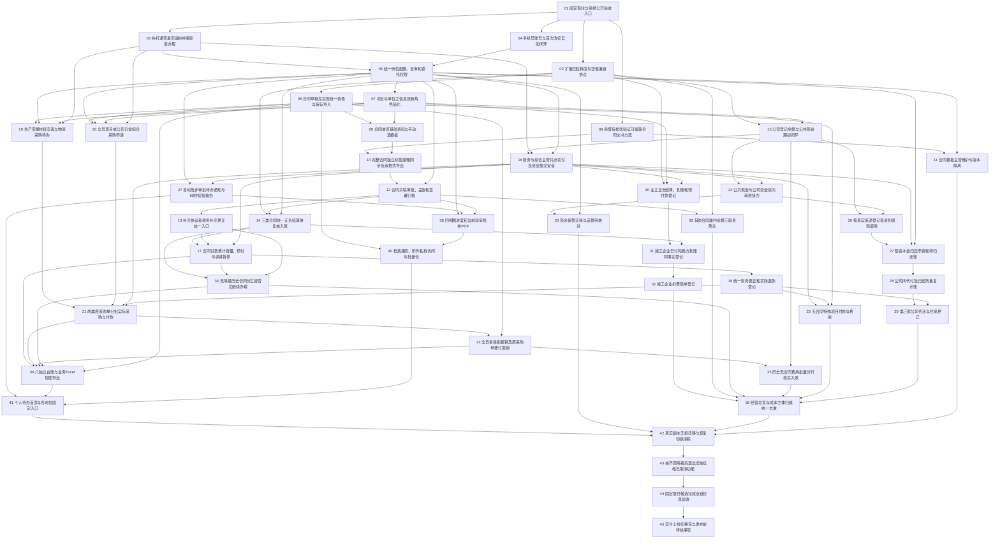

# 业务简化重构已确认任务与依赖图

> 2026-11-05规格、2026-11-06执行更新；用户已确认方案与验收边界，授权193条规格、45任务及GitHub推进。父工单[#382](https://github.com/1131096740/intelligent-construction-management/issues/382)、子工单#383～#427已发布；编号及依赖边不变。当前7/45按各自边界关闭：01准备、02/03本地阶段PG待验、04本地、05补修后本地、07本地、08文书技术CLI。06/11继续，15前置已满足待领取，09仍等06；09/15测试边界已确认。

> **2026-11-06 补修收口：** 05曾因委托全局guard接线遗漏重开，现与07同树整合于准确中央`ecbed5a4`，最终两轴0、中央API1151/Web5及原369通过后已重新关闭05并关闭07。此前5/45、6/45为历史里程碑；真实PG/迁移/资源、实时银行及部署未执行，16/42/44硬门保留。

来源：[193条完整规格](../../specs/2026-11-05-enterprise-simplification-spec.md)、[技术方案](../2026-11-05-enterprise-simplification-technical-plan.md)、[差距依据](../2026-11-05-enterprise-simplification-evidence-and-gaps.md)、[验收边界](../2026-11-05-enterprise-simplification-acceptance.md)。每个票据写明交付、阻塞关系、逐条需求验收、技术决定及测试情景。

工单逐项映射与源码指纹见 [Issue 映射](../2026-11-05-enterprise-simplification-issue-map.json)，当前基线与停止条件见[集成起步交接](../../progress/2026-11-05-enterprise-simplification-integration-start.md)。

07已按确认本地边界[关闭#389](https://github.com/1131096740/intelligent-construction-management/issues/389#issuecomment-6664057327)，05接线补修已[重新关闭#387](https://github.com/1131096740/intelligent-construction-management/issues/387#issuecomment-6664056124)。15仅解除源码前置，实际领取仍需登记；真实PG、银行与16/42/44门不计通过。[整合收据](../../progress/2026-11-05-enterprise-simplification-task07-integrated.md)。

## 执行原则

业务按可演示的端到端片拆；精度协议的expand/contract是宽改例外，中间由各业务片逐域迁移。前置验证和最终综合验收独立成片，不伪装为业务功能。只做前沿票据，遇新发现先记录，不擅自扩大共享Schema或相邻模块。01为prepared-complete/github-closed，04为local-confirmed-boundary-complete/github-closed；02/03按用户确认成为local-stage-complete/pg-pending/github-closed，05为local-confirmed-boundary-complete/pg-pending/github-closed，06为in-progress，08为technical-cli-complete/github-closed；07为local-confirmed-boundary-complete/pg-pending/github-closed，11为in-progress；15前置已满足待领取，09仍等06。仅解除源码实施依赖，真实PG仍不计通过，16/42/44发布前硬门保留；其它阻塞边不变。迁移、受控资源及部署仍需各自具体授权。

用户希望最终整体可用，因此实现可以逐片验证，用户侧统一切新机制；不提供旧结算/新结算双模式。最终资金提交、数据恢复、文书与权限有任何硬门未过，不宣布可上线。

## 编号清单与真正阻塞边

| 票据 | Blocked by | 完成交付 |
| --- | --- | --- |
| [01 固定现状与受控公开验收入口](01-baseline.md) | 无 | 形成可复核的源码、Schema、迁移、运行角色与真实数据保留基线；为随后每片提供可运行的公开HTTP/PG/Web验收入口，不启动未获准的实验。 |
| [02 扩展四位精度与空值兼容协议](02-precision-expand.md) | 01 | 以一个合同草稿清单贯穿输入、保存、重读和导出，建立十进制4位与实际支付分的兼容协议，保留所有旧调用者。 |
| [03 先打通零星申请的并联职责办理](03-parallel-core.md) | 01 | 既有零星材料申请的物资主管和项目经理同时收到任务，任一驳回回草稿，两职责全同意才通过；为其他流程提供版本化职责协议。 |
| [04 手机号账号与首次改密自助闭环](04-identity.md) | 01 | 管理员建立账号无需验证码，人员首次登录强改密码，改新手机号验证新号，忘密自助恢复；历史人员引用不变。 |
| [05 统一岗位配置、自审和委托权限](05-personnel.md) | 03、04 | 从系统管理配置人员、项目岗位及临时委托；公司岗位跨项目办理本职业务，创建人/提交人自审有原因和密码验证。 |
| [06 合同草稿先实现统一表格与保存导入](06-grid-drafts.md) | 02 | 一个真实合同草稿清单具备原型选择/键盘/批量/撤销、自动与手动保存、中文导入预检，再把同一交互用于后续明细。 |
| [07 项目与单位主信息按新角色简化](07-projects-units.md) | 05 | 授权人员维护项目和现有单位档案，项目唯一施工企业、可有多家我方公司；人员入口与完工状态明确。 |
| [08 用既有样张验证可编辑合同文书方案](08-document-proof.md) | 01 | 用实际现有模板做可运行、可丢弃的正文编辑/字段同步/PDF与Word一致验证，固定后续正式实现的可行方案。 |
| [09 合同单页基础资料与手动选模板](09-contract-form.md) | 06、07 | 合同员在宽单页按实际填写关系、双方、框架/包干/清单、含税或待补信息和付款文本，自选模板生成草稿。 |
| [10 完整合同独立标签编辑同步及双格式导出](10-contract-document.md) | 08、09 | 生成的完整正文在独立标签查看和编辑普通条款，关键字段由填写页同步；保留手工修改并导出可签署PDF/Word。 |
| [11 合同模板主管维护与版本隔离](11-templates.md) | 08、05 | 合同主管从明显入口上传Word确认映射、维护版本及停用，合同员手动选可用模板；旧合同不受影响。 |
| [12 合同并联审批、盖章和签署归档](12-contract-lifecycle.md) | 10、05 | 按业务类型全员并联审批，之后综合主管盖章确认、合同员上传双方盖章PDF直接归档；表外/对上直接签署登记也完整可用。 |
| [13 补充协议和税务补充更正统一入口](13-contract-changes.md) | 12 | 从合同台账或详情明显入口提交已签补充协议/变更，主管复核生效；税务待补直接补，已填更正复核。 |
| [14 三类合同统一正负结算单复核入账](14-settlements.md) | 02、12、05 | 合同员选项目合同、手填编号金额、上传已签PDF/照片，主管复核计累计；确认后只可另开正负结算，保持一入口。 |
| [15 公司登记余额与公共现金期初闭环](15-fund-accounts.md) | 02、07 | 从资金账户清楚查看每公司登记余额和唯一公共现金，录入可核对期初；项目归属与资金容器分开。 |
| [16 财务与综合主管共办实付及资金提交安全](16-payment-execution.md) | 15、03、05 | 审批通过的既有付款由财务和综合主管共享待办，分次选择公司资金或现金记录线下实付，全部付清任务消失。 |
| [17 合同付款累计容量、预付与调减暂停](17-contract-payment.md) | 14、13、16 | 综合部只选最新结算，以累计/净已付/全部在途占用发起付款；合同约定仅提示，合法预付款和其他合同直接付款可办理。 |
| [18 统一财务更正和实际退款登记](18-financial-correction.md) | 17 | 统一更正按钮按状态引导；财务登记错误复核补偿，已收退款关联原实付，分别重算净付款、成本和可付款。 |
| [19 生产零星材料申请与物资采购待办](19-spot-request.md) | 06、05、07、03 | 项目物资员/物资主管以统一网格申请生产零星材料，主管和项目经理并联通过后推送本项目物资员采购。 |
| [20 全员项目或公司日常综合采购申请](20-general-request.md) | 06、05、07、03 | 全员申请办公物品/服务/软件等，项目综合主管+项目经理并联，公司日常仅综合主管；通过后综合部采购。 |
| [21 两类原采购单分批实际采购与付款](21-actual-procurement.md) | 19、20、16、18 | 原单记录多供应商/多批实际采购，各批发起付款并查看已付待付；首次付款通过确认整批成本，后续付款不重复。 |
| [22 全员多类别报销及原采购单垫付报销](22-reimbursement.md) | 21、06 | 任何员工可以按项目或公司日常填分类费用网格，统一凭证，从原采购单或无采购直接报销，公司给垫付员工付款。 |
| [23 无合同特殊项目付款与费用](23-other-project-payment.md) | 16、18、06 | 综合部从明显入口为真实无合同项目支出填费用并申请标准项目付款，审批确认费用、分次实付不重计。 |
| [24 公共现金与公司资金双向转款接力](24-cash-transfers.md) | 15、16 | 综合主管登记现金转公司，财务确认实际到账；公司转现金由保管人确认，两边不同时可用。 |
| [25 现金保管交接与差额待核对](25-cash-handover.md) | 24、05 | 现金保管变更记录交出与实点接收；旧保管人离职由财务发起，新保管人确认，差额待核对。 |
| [26 按真实来源登记垫资到账和使用](26-funding-receipt.md) | 15、24 | 财务/综合主管直接登记真实垫资，公共现金或公司账户保留多出资方来源；公司补足项目资金经确认形成相应往来。 |
| [27 垫资本金归还申请和待归还账](27-funding-return.md) | 26、16、05 | 综合部关联原出资批次分次申请本金归还，按项目/非项目职责并联，财务或综合主管登记实际归还。 |
| [28 公司间代付及归还防重复计账](28-intercompany.md) | 27 | A业务由B实际代付形成A欠B，综合部按原往来申请归还，财务执行后债权减少，不复制原业务成本。 |
| [29 第三家公司代还与往来更正](29-third-company-return.md) | 28、18 | C替A归还B时原A-B债权减少、A-C增加，并以原归还链追溯，财务更正守恒。 |
| [30 业主正负结算、到账和预付款登记](30-owner-business.md) | 02、07、16 | 综合/财务从项目经营明显入口记录业主结算及已确认到账，允许预付、负结算，明确未结算预付与欠收。 |
| [31 施工企业已付和我方到账同事实登记](31-construction-payments.md) | 30、14 | 根据凭证登记施工企业对下游/我方实际支付，形成施工企业已付金额；转我方同时关联我方到账。 |
| [32 施工企业扣费简单登记](32-construction-fees.md) | 31 | 综合/财务按费用名称金额登记施工企业实际扣费，项目经营与对应资金反映；剩余资金不自动称利润。 |
| [33 其他合同履约金额三职责确认](33-other-contract-cost.md) | 12、02 | 其他合同实际已完成工作金额由合同主管、项目经理及财务同时确认，形成成本，不依赖付款额猜测。 |
| [34 无等级历史合同分工接管后继续办理](34-history-contracts.md) | 14、17、13 | 合同部简录三类已签历史合同和累计结算，财务填历史实付/收，主管复核后入台账，接续新结算付款。 |
| [35 历史无合同费用批量分行核实入账](35-history-expenses.md) | 22、15 | 综合部按项目批量网格登记历史费用，财务按已核清行确认成本和历史付款，未核清行留待办。 |
| [36 经营总览与成本主体归属统一去重](36-operating-projections.md) | 32、33、34、35、23、29 | 项目总览显示确认收入成本、当前盈亏、欠款/预付、施工企业已付与项目对外支付，公共现金费用待归属可核对补公司。 |
| [37 自动及非审批待办通知与60秒短信催办](37-notifications.md) | 05、16 | 网页铃铛/手机页顶显示当前待办，所有可办环节自动短信，流程可选人催办，失败不阻断业务。 |
| [38 四视图进度和当前轮审批单PDF](38-approval-center.md) | 05、37、12 | 审批中心我审批/我发起/我参与/我可查看四视图，显示全部并联职责和摘要，详情集中原单附件进度当前PDF及催办。 |
| [39 六独立台账与业务Excel视图导出](39-ledgers.md) | 17、21、22、34、06 | 合同、结算、付款、零星材料、综合采购、报销六页面统一筛选/列视图/回原单及精美Excel导出。 |
| [40 档案搜索、附件私有访问与批量包](40-archives-search.md) | 06、38 | 有权用户按项目/合同/编号搜索业务、在档案表格查看附件和多选打包下载，入口无需密码或原因表单。 |
| [41 个人待办首页与各岗位固定入口](41-navigation.md) | 37、39、40 | 成熟简洁首页以本人待办为主，工作台待办/草稿再新建，独立台账、资金、经营和管理入口就近可发现。 |
| [42 真实副本无损迁移与恢复切换演练](42-migration-rehearsal.md) | 41、25、36、11 | 形成可恢复备份、精度/职责/资金来源/历史基线映射及真实副本演练报告，明确写前与写后回退边界。 |
| [43 核齐调用者后退出旧协议和已取消功能](43-retire-old.md) | 42 | 在各领域已移除旧前置并完成兼容迁移后，收缩旧数值写协议、串联入口和取消功能，保护真实档案与共用链。 |
| [44 固定最终候选完成全链仿真验收](44-final-acceptance.md) | 43 | 同一固定候选贯穿合同/结算/资金/采购/报销/历史/经营，完成真实PG竞争和页面仿真，给出可追溯最终验收报告。 |
| [45 交付上线切换包与发布前待核事项](45-cutover-packet.md) | 44 | 交付精确候选、兼容矩阵、对账报告、恢复验证、停写/放写/观察/回退步骤及可审阅的上线决策材料，不执行生产操作。 |

## 依赖图

箭头A→B表示A完成才可开始B；下表/各票据是完整边的权威记录。图中并列不等于要求多代理或并发改同一工作区；实际按资源和文件归属选择前沿。

## 需求覆盖矩阵

每条规格有且仅有一个主交付票；相关业务片还必须遵守全局精度、权限、通知和迁移约束。主交付票不意味着其他票可以不满足同一全局规则。

| 需求 | 主交付票 | 用户目标 |
| --- | --- | --- |
| BAS-01 | [01 固定现状与受控公开验收入口](01-baseline.md) | 用一套响应式网页承载业务 |
| BAS-02 | [09 合同单页基础资料与手动选模板](09-contract-form.md) | 只填必要信息、自己判断业务约定 |
| BAS-03 | [44 固定最终候选完成全链仿真验收](44-final-acceptance.md) | 覆盖已确认的全部保留模块 |
| BAS-04 | [07 项目与单位主信息按新角色简化](07-projects-units.md) | 明确表内、表外与对上含义 |
| BAS-05 | [44 固定最终候选完成全链仿真验收](44-final-acceptance.md) | 按真实规模验证 |
| BAS-06 | [02 扩展四位精度与空值兼容协议](02-precision-expand.md) | 使用明确日期与提示 |
| UI-01 | [41 个人待办首页与各岗位固定入口](41-navigation.md) | 首页先看本人待办 |
| UI-02 | [41 个人待办首页与各岗位固定入口](41-navigation.md) | 只看到有权使用的固定入口 |
| UI-03 | [41 个人待办首页与各岗位固定入口](41-navigation.md) | 工作台先找待办与草稿、再新建 |
| UI-04 | [06 合同草稿先实现统一表格与保存导入](06-grid-drafts.md) | 在所有适合的明细中使用统一表格 |
| UI-05 | [06 合同草稿先实现统一表格与保存导入](06-grid-drafts.md) | 直接编辑并连续录入单元格 |
| UI-06 | [06 合同草稿先实现统一表格与保存导入](06-grid-drafts.md) | 就近操作和批量处理草稿行 |
| UI-07 | [06 合同草稿先实现统一表格与保存导入](06-grid-drafts.md) | 保持页面稳定和表格易读 |
| UI-08 | [06 合同草稿先实现统一表格与保存导入](06-grid-drafts.md) | 优先沿用稳定表格体验 |
| UI-09 | [06 合同草稿先实现统一表格与保存导入](06-grid-drafts.md) | 自动和手动保存草稿 |
| UI-10 | [06 合同草稿先实现统一表格与保存导入](06-grid-drafts.md) | 断网保留输入并防止重复操作 |
| UI-11 | [39 六独立台账与业务Excel视图导出](39-ledgers.md) | 分别打开六类独立台账 |
| UI-12 | [39 六独立台账与业务Excel视图导出](39-ledgers.md) | 按实际业务对象查看台账 |
| UI-13 | [39 六独立台账与业务Excel视图导出](39-ledgers.md) | 按个人习惯查看台账 |
| UI-14 | [39 六独立台账与业务Excel视图导出](39-ledgers.md) | 导出精美业务Excel |
| UI-15 | [06 合同草稿先实现统一表格与保存导入](06-grid-drafts.md) | 使用Excel模板和导入预览 |
| UI-16 | [40 档案搜索、附件私有访问与批量包](40-archives-search.md) | 查找档案并批量下载 |
| UI-17 | [40 档案搜索、附件私有访问与批量包](40-archives-search.md) | 全局搜索有权业务 |
| NUM-01 | [02 扩展四位精度与空值兼容协议](02-precision-expand.md) | 按统一精度录入 |
| NUM-02 | [02 扩展四位精度与空值兼容协议](02-precision-expand.md) | 信任清单合计 |
| NUM-03 | [02 扩展四位精度与空值兼容协议](02-precision-expand.md) | 按累计数计算支付口径 |
| NUM-04 | [02 扩展四位精度与空值兼容协议](02-precision-expand.md) | 没有虚假尾差 |
| NUM-05 | [02 扩展四位精度与空值兼容协议](02-precision-expand.md) | 保留未知与真实原值 |
| CON-01 | [09 合同单页基础资料与手动选模板](09-contract-form.md) | 选择合同关系与业务类型 |
| CON-02 | [09 合同单页基础资料与手动选模板](09-contract-form.md) | 按实际合同选择办理方式 |
| CON-03 | [09 合同单页基础资料与手动选模板](09-contract-form.md) | 先填关键信息再看完整正文 |
| CON-04 | [09 合同单页基础资料与手动选模板](09-contract-form.md) | 用最少必填生成合同 |
| CON-05 | [09 合同单页基础资料与手动选模板](09-contract-form.md) | 搜索单位或直接填名称 |
| CON-06 | [09 合同单页基础资料与手动选模板](09-contract-form.md) | 按实际计价填写 |
| CON-07 | [09 合同单页基础资料与手动选模板](09-contract-form.md) | 如实记录付款及结算约定 |
| CON-08 | [09 合同单页基础资料与手动选模板](09-contract-form.md) | 在合同层处理税务 |
| CON-09 | [09 合同单页基础资料与手动选模板](09-contract-form.md) | 自主选模板 |
| CON-10 | [10 完整合同独立标签编辑同步及双格式导出](10-contract-document.md) | 自由修改普通条款和增加条款 |
| CON-11 | [10 完整合同独立标签编辑同步及双格式导出](10-contract-document.md) | 保持正文与台账关键数据一致 |
| CON-12 | [10 完整合同独立标签编辑同步及双格式导出](10-contract-document.md) | 修改关键资料时保留手工条款 |
| CON-13 | [10 完整合同独立标签编辑同步及双格式导出](10-contract-document.md) | 下载正式可用合同 |
| CON-14 | [10 完整合同独立标签编辑同步及双格式导出](10-contract-document.md) | 阅读和编辑正文 |
| CON-15 | [12 合同并联审批、盖章和签署归档](12-contract-lifecycle.md) | 先内部审批再线下签章 |
| CON-16 | [12 合同并联审批、盖章和签署归档](12-contract-lifecycle.md) | 收到盖章待办 |
| CON-17 | [12 合同并联审批、盖章和签署归档](12-contract-lifecycle.md) | 收到归档待办并直接归档 |
| CON-18 | [12 合同并联审批、盖章和签署归档](12-contract-lifecycle.md) | 在审批中修改正文 |
| CON-19 | [13 补充协议和税务补充更正统一入口](13-contract-changes.md) | 维护已签合同的后续约定 |
| CON-20 | [13 补充协议和税务补充更正统一入口](13-contract-changes.md) | 核对当前合同金额和条款 |
| CON-21 | [13 补充协议和税务补充更正统一入口](13-contract-changes.md) | 看到补充协议的新付款约定 |
| CON-22 | [11 合同模板主管维护与版本隔离](11-templates.md) | 维护共用模板 |
| CON-23 | [09 合同单页基础资料与手动选模板](09-contract-form.md) | 正确使用编号 |
| SET-01 | [14 三类合同统一正负结算单复核入账](14-settlements.md) | 登记自己项目的已签结算 |
| SET-02 | [14 三类合同统一正负结算单复核入账](14-settlements.md) | 自己填写结算编号 |
| SET-03 | [14 三类合同统一正负结算单复核入账](14-settlements.md) | 统一登记正负结算 |
| SET-04 | [14 三类合同统一正负结算单复核入账](14-settlements.md) | 复核登记金额和附件 |
| SET-05 | [14 三类合同统一正负结算单复核入账](14-settlements.md) | 被驳回后继续原草稿 |
| SET-06 | [14 三类合同统一正负结算单复核入账](14-settlements.md) | 信任累计结算 |
| SET-07 | [14 三类合同统一正负结算单复核入账](14-settlements.md) | 保留已确认原单 |
| SET-08 | [14 三类合同统一正负结算单复核入账](14-settlements.md) | 兼任经办登记 |
| SET-09 | [14 三类合同统一正负结算单复核入账](14-settlements.md) | 用最新累计结算申请付款 |
| SET-10 | [14 三类合同统一正负结算单复核入账](14-settlements.md) | 上传多页已签单据 |
| PAY-01 | [17 合同付款累计容量、预付与调减暂停](17-contract-payment.md) | 按合同发起付款 |
| PAY-02 | [17 合同付款累计容量、预付与调减暂停](17-contract-payment.md) | 明显看到付款约定 |
| PAY-03 | [17 合同付款累计容量、预付与调减暂停](17-contract-payment.md) | 按合同净余额避免重复付款 |
| PAY-04 | [17 合同付款累计容量、预付与调减暂停](17-contract-payment.md) | 处理结算调减后的在途申请 |
| PAY-05 | [17 合同付款累计容量、预付与调减暂停](17-contract-payment.md) | 调整尚未支付部分 |
| PAY-06 | [18 统一财务更正和实际退款登记](18-financial-correction.md) | 看到超付及回款差额 |
| PAY-07 | [17 合同付款累计容量、预付与调减暂停](17-contract-payment.md) | 办理合同预付款 |
| PAY-08 | [17 合同付款累计容量、预付与调减暂停](17-contract-payment.md) | 区分预付款和异常超付 |
| PAY-09 | [17 合同付款累计容量、预付与调减暂停](17-contract-payment.md) | 办理其他合同直接付款 |
| PAY-10 | [17 合同付款累计容量、预付与调减暂停](17-contract-payment.md) | 照实选择收款信息 |
| PAY-11 | [16 财务与综合主管共办实付及资金提交安全](16-payment-execution.md) | 审批后都能办理实付 |
| PAY-12 | [16 财务与综合主管共办实付及资金提交安全](16-payment-execution.md) | 部分付款后继续办理 |
| PAY-13 | [16 财务与综合主管共办实付及资金提交安全](16-payment-execution.md) | 稍后补付款凭证 |
| PAY-14 | [18 统一财务更正和实际退款登记](18-financial-correction.md) | 更正错误付款登记 |
| PAY-15 | [18 统一财务更正和实际退款登记](18-financial-correction.md) | 登记已经收到的退款 |
| PAY-16 | [18 统一财务更正和实际退款登记](18-financial-correction.md) | 区分退款的成本效果 |
| PAY-17 | [23 无合同特殊项目付款与费用](23-other-project-payment.md) | 办理无合同特殊项目支出 |
| PUR-01 | [19 生产零星材料申请与物资采购待办](19-spot-request.md) | 单独办理生产所需零星材料 |
| PUR-02 | [20 全员项目或公司日常综合采购申请](20-general-request.md) | 申请综合采购 |
| PUR-03 | [20 全员项目或公司日常综合采购申请](20-general-request.md) | 只明确需要什么 |
| PUR-04 | [20 全员项目或公司日常综合采购申请](20-general-request.md) | 按审批结果收到采购待办 |
| PUR-05 | [20 全员项目或公司日常综合采购申请](20-general-request.md) | 不办理收货登记 |
| PUR-06 | [20 全员项目或公司日常综合采购申请](20-general-request.md) | 按实际数量和价格办理 |
| PUR-07 | [21 两类原采购单分批实际采购与付款](21-actual-procurement.md) | 记录各批实际采购 |
| PUR-08 | [21 两类原采购单分批实际采购与付款](21-actual-procurement.md) | 灵活申请实际支付金额 |
| PUR-09 | [21 两类原采购单分批实际采购与付款](21-actual-procurement.md) | 按批次确认成本 |
| PUR-10 | [21 两类原采购单分批实际采购与付款](21-actual-procurement.md) | 核对更正采购金额 |
| PUR-11 | [21 两类原采购单分批实际采购与付款](21-actual-procurement.md) | 追踪各次付款 |
| PUR-12 | [22 全员多类别报销及原采购单垫付报销](22-reimbursement.md) | 从原采购单报销 |
| EXP-01 | [22 全员多类别报销及原采购单垫付报销](22-reimbursement.md) | 直接报销或关联采购报销 |
| EXP-02 | [22 全员多类别报销及原采购单垫付报销](22-reimbursement.md) | 逐项录入明细 |
| EXP-03 | [22 全员多类别报销及原采购单垫付报销](22-reimbursement.md) | 按项目归集 |
| EXP-04 | [22 全员多类别报销及原采购单垫付报销](22-reimbursement.md) | 统一上传凭证 |
| EXP-05 | [22 全员多类别报销及原采购单垫付报销](22-reimbursement.md) | 审批后追加凭证 |
| EXP-06 | [22 全员多类别报销及原采购单垫付报销](22-reimbursement.md) | 按确认费用计成本 |
| EXP-07 | [22 全员多类别报销及原采购单垫付报销](22-reimbursement.md) | 使用可复用费用类别 |
| EXP-08 | [22 全员多类别报销及原采购单垫付报销](22-reimbursement.md) | 用业务入口与分类各司其职 |
| HIS-01 | [34 无等级历史合同分工接管后继续办理](34-history-contracts.md) | 简易接管三类历史合同 |
| HIS-02 | [34 无等级历史合同分工接管后继续办理](34-history-contracts.md) | 不选接管等级 |
| HIS-03 | [34 无等级历史合同分工接管后继续办理](34-history-contracts.md) | 填写历史实际收付 |
| HIS-04 | [34 无等级历史合同分工接管后继续办理](34-history-contracts.md) | 一次看齐后复核 |
| HIS-05 | [34 无等级历史合同分工接管后继续办理](34-history-contracts.md) | 按驳回意见补资料 |
| HIS-06 | [34 无等级历史合同分工接管后继续办理](34-history-contracts.md) | 未知保持原阶段 |
| HIS-07 | [34 无等级历史合同分工接管后继续办理](34-history-contracts.md) | 如实接管超付超收 |
| HIS-08 | [34 无等级历史合同分工接管后继续办理](34-history-contracts.md) | 接管后办理结算和付款 |
| HIS-09 | [13 补充协议和税务补充更正统一入口](13-contract-changes.md) | 补充和更正税务 |
| HIS-10 | [35 历史无合同费用批量分行核实入账](35-history-expenses.md) | 批量录入历史无合同费用 |
| HIS-11 | [35 历史无合同费用批量分行核实入账](35-history-expenses.md) | 按核清记录分批入账 |
| HIS-12 | [34 无等级历史合同分工接管后继续办理](34-history-contracts.md) | 历史付款不重复扣期初 |
| FND-01 | [15 公司登记余额与公共现金期初闭环](15-fund-accounts.md) | 用明显统一入口 |
| FND-02 | [15 公司登记余额与公共现金期初闭环](15-fund-accounts.md) | 只看公司登记资金 |
| FND-03 | [15 公司登记余额与公共现金期初闭环](15-fund-accounts.md) | 保管公共现金 |
| FND-04 | [15 公司登记余额与公共现金期初闭环](15-fund-accounts.md) | 区分账户资金与项目归属 |
| FND-05 | [26 按真实来源登记垫资到账和使用](26-funding-receipt.md) | 直接登记真实垫资到账 |
| FND-06 | [15 公司登记余额与公共现金期初闭环](15-fund-accounts.md) | 登记多项目周转现金 |
| FND-07 | [26 按真实来源登记垫资到账和使用](26-funding-receipt.md) | 按实际资金来源支付 |
| FND-08 | [15 公司登记余额与公共现金期初闭环](15-fund-accounts.md) | 查清余额差异后登记 |
| FND-09 | [24 公共现金与公司资金双向转款接力](24-cash-transfers.md) | 现金转入公司 |
| FND-10 | [24 公共现金与公司资金双向转款接力](24-cash-transfers.md) | 处理被驳回转款 |
| FND-11 | [24 公共现金与公司资金双向转款接力](24-cash-transfers.md) | 公司资金转公共现金 |
| FND-12 | [26 按真实来源登记垫资到账和使用](26-funding-receipt.md) | 追溯公共资金出资方 |
| FND-13 | [15 公司登记余额与公共现金期初闭环](15-fund-accounts.md) | 核对现金起点 |
| FND-14 | [25 现金保管交接与差额待核对](25-cash-handover.md) | 交接现金 |
| FND-15 | [27 垫资本金归还申请和待归还账](27-funding-return.md) | 申请归还项目垫资 |
| FND-16 | [27 垫资本金归还申请和待归还账](27-funding-return.md) | 防止重复归还 |
| FND-17 | [27 垫资本金归还申请和待归还账](27-funding-return.md) | 查看待归还 |
| FND-18 | [26 按真实来源登记垫资到账和使用](26-funding-receipt.md) | 确认公司替项目补足资金 |
| FND-19 | [28 公司间代付及归还防重复计账](28-intercompany.md) | 准确记录公司间代付 |
| FND-20 | [28 公司间代付及归还防重复计账](28-intercompany.md) | 申请公司间代付款归还 |
| FND-21 | [29 第三家公司代还与往来更正](29-third-company-return.md) | 记录第三家公司代还 |
| FND-22 | [36 经营总览与成本主体归属统一去重](36-operating-projections.md) | 按现金实际支出归集成本 |
| FND-23 | [36 经营总览与成本主体归属统一去重](36-operating-projections.md) | 多维查看资金流水 |
| OPS-01 | [30 业主正负结算、到账和预付款登记](30-owner-business.md) | 登记业主结算和付款 |
| OPS-02 | [30 业主正负结算、到账和预付款登记](30-owner-business.md) | 登记业主预付款 |
| OPS-03 | [30 业主正负结算、到账和预付款登记](30-owner-business.md) | 调减业主结算 |
| OPS-04 | [31 施工企业已付和我方到账同事实登记](31-construction-payments.md) | 登记施工企业付款 |
| OPS-05 | [31 施工企业已付和我方到账同事实登记](31-construction-payments.md) | 区分有结算与超付 |
| OPS-06 | [30 业主正负结算、到账和预付款登记](30-owner-business.md) | 登记前核实到账 |
| OPS-07 | [31 施工企业已付和我方到账同事实登记](31-construction-payments.md) | 看清施工企业实际支出 |
| OPS-08 | [32 施工企业扣费简单登记](32-construction-fees.md) | 登记施工企业实际扣费 |
| OPS-09 | [31 施工企业已付和我方到账同事实登记](31-construction-payments.md) | 更正外部付款错误 |
| OPS-10 | [32 施工企业扣费简单登记](32-construction-fees.md) | 区分资金所在和利润 |
| OPS-11 | [36 经营总览与成本主体归属统一去重](36-operating-projections.md) | 合并经营避免内部重复 |
| OPS-12 | [36 经营总览与成本主体归属统一去重](36-operating-projections.md) | 区分企业支付与项目对外支付 |
| OPS-13 | [36 经营总览与成本主体归属统一去重](36-operating-projections.md) | 看当前经营盈亏 |
| OPS-14 | [36 经营总览与成本主体归属统一去重](36-operating-projections.md) | 区分未付的不同状态 |
| OPS-15 | [36 经营总览与成本主体归属统一去重](36-operating-projections.md) | 看业主及施工企业欠款 |
| OPS-16 | [33 其他合同履约金额三职责确认](33-other-contract-cost.md) | 确认其他合同履约成本 |
| APR-01 | [03 先打通零星申请的并联职责办理](03-parallel-core.md) | 所有正式审批并联办理 |
| APR-02 | [03 先打通零星申请的并联职责办理](03-parallel-core.md) | 任意岗位驳回返制单 |
| APR-03 | [03 先打通零星申请的并联职责办理](03-parallel-core.md) | 同意时使用本人手写签名 |
| APR-04 | [05 统一岗位配置、自审和委托权限](05-personnel.md) | 本人发起也可审批 |
| APR-05 | [03 先打通零星申请的并联职责办理](03-parallel-core.md) | 未全通过时撤回 |
| APR-06 | [38 四视图进度和当前轮审批单PDF](38-approval-center.md) | 只看新一轮有效审批单 |
| APR-07 | [38 四视图进度和当前轮审批单PDF](38-approval-center.md) | 查看完整可视进度 |
| APR-08 | [38 四视图进度和当前轮审批单PDF](38-approval-center.md) | 在四个视图找流程 |
| APR-09 | [38 四视图进度和当前轮审批单PDF](38-approval-center.md) | 集中看进度与文书 |
| APR-10 | [38 四视图进度和当前轮审批单PDF](38-approval-center.md) | 下载审批中PDF |
| APR-11 | [03 先打通零星申请的并联职责办理](03-parallel-core.md) | 补齐空缺岗位 |
| APR-12 | [05 统一岗位配置、自审和委托权限](05-personnel.md) | 临时委托办理 |
| APR-13 | [18 统一财务更正和实际退款登记](18-financial-correction.md) | 找到统一更正入口 |
| APR-14 | [18 统一财务更正和实际退款登记](18-financial-correction.md) | 确认金融更正 |
| NTF-01 | [37 自动及非审批待办通知与60秒短信催办](37-notifications.md) | 右下角铃铛看到新事项 |
| NTF-02 | [37 自动及非审批待办通知与60秒短信催办](37-notifications.md) | 网页顶部看到新事项 |
| NTF-03 | [37 自动及非审批待办通知与60秒短信催办](37-notifications.md) | 看到待办数而非已读数 |
| NTF-04 | [37 自动及非审批待办通知与60秒短信催办](37-notifications.md) | 新待办自动短信 |
| NTF-05 | [37 自动及非审批待办通知与60秒短信催办](37-notifications.md) | 短信有丰富摘要和链接 |
| NTF-06 | [37 自动及非审批待办通知与60秒短信催办](37-notifications.md) | 催办所有或指定未办理人员 |
| NTF-07 | [37 自动及非审批待办通知与60秒短信催办](37-notifications.md) | 短信异常不阻断业务 |
| NTF-08 | [37 自动及非审批待办通知与60秒短信催办](37-notifications.md) | 旧链接准确显示处理结果 |
| NTF-09 | [37 自动及非审批待办通知与60秒短信催办](37-notifications.md) | 以账号手机号接收短信 |
| IAM-01 | [05 统一岗位配置、自审和委托权限](05-personnel.md) | 从系统管理配置人员与岗位 |
| IAM-02 | [05 统一岗位配置、自审和委托权限](05-personnel.md) | 管理所有项目本职业务 |
| IAM-03 | [05 统一岗位配置、自审和委托权限](05-personnel.md) | 跨项目核对合同结算付款 |
| IAM-04 | [40 档案搜索、附件私有访问与批量包](40-archives-search.md) | 预览下载附件 |
| IAM-05 | [05 统一岗位配置、自审和委托权限](05-personnel.md) | 停用离职账号和替换岗位 |
| IAM-06 | [04 手机号账号与首次改密自助闭环](04-identity.md) | 变更手机号且验证新号码 |
| IAM-07 | [04 手机号账号与首次改密自助闭环](04-identity.md) | 首次使用自己的密码 |
| IAM-08 | [04 手机号账号与首次改密自助闭环](04-identity.md) | 忘记密码自助恢复 |
| IAM-09 | [07 项目与单位主信息按新角色简化](07-projects-units.md) | 建立项目并修正基础资料 |
| IAM-10 | [07 项目与单位主信息按新角色简化](07-projects-units.md) | 保持项目主体清楚 |
| IAM-11 | [07 项目与单位主信息按新角色简化](07-projects-units.md) | 查看人员与完工后业务 |
| IAM-12 | [07 项目与单位主信息按新角色简化](07-projects-units.md) | 维护现有单位档案 |
| IAM-13 | [05 统一岗位配置、自审和委托权限](05-personnel.md) | 查询审计日志 |
| CUT-01 | [42 真实副本无损迁移与恢复切换演练](42-migration-rehearsal.md) | 保留真实数据迁移 |
| CUT-02 | [42 真实副本无损迁移与恢复切换演练](42-migration-rehearsal.md) | 继续处理真实在途审批 |
| CUT-03 | [14 三类合同统一正负结算单复核入账](14-settlements.md) | 直接使用新结算流程 |
| CUT-04 | [43 核齐调用者后退出旧协议和已取消功能](43-retire-old.md) | 明确未用模块退出 |
| CUT-05 | [42 真实副本无损迁移与恢复切换演练](42-migration-rehearsal.md) | 安全切换 |
| CUT-06 | [42 真实副本无损迁移与恢复切换演练](42-migration-rehearsal.md) | 保留可恢复数据 |
| CUT-07 | [44 固定最终候选完成全链仿真验收](44-final-acceptance.md) | 由代理执行仿真验收 |
| CUT-08 | [44 固定最终候选完成全链仿真验收](44-final-acceptance.md) | 用一个最终候选验收 |

## 新会话使用方式

按已确认任务图，从本图挑一张前置已完成的票，在同一项目新会话引用“完整规格+技术方案+该票”。先读PROGRESS并核实前置结果与候选指纹；一次只实施当前授权票的完整业务边界，完成公开验收后交接。不要再粘贴数百轮聊天重建规则，也不要一句“全部大重构”跳过逐片证据。

可使用项目实际存在的 `/implement-spec` 在明确票据范围内实施；是否可调用仍需新会话读取对应技能，不能把本文当作已执行。文档与任务获确认不自动授权Git提交/发布、数据库迁移或部署。

## 确认结论与下一步

用户已确认整套实施；当前7/45分别按准备、本地或技术边界完成。05补修与07以准确ecbed中央同树验证、推送并收票，06/11继续。09/15公开HTTP、公共服务、真实UI及合成数据库边界已确认，15前置已满足待领取，09仍等06。每票依原图推进；本地收口不证明真实PG、迁移、恢复或发布门通过，不授予资源、实际交易或部署权限。
